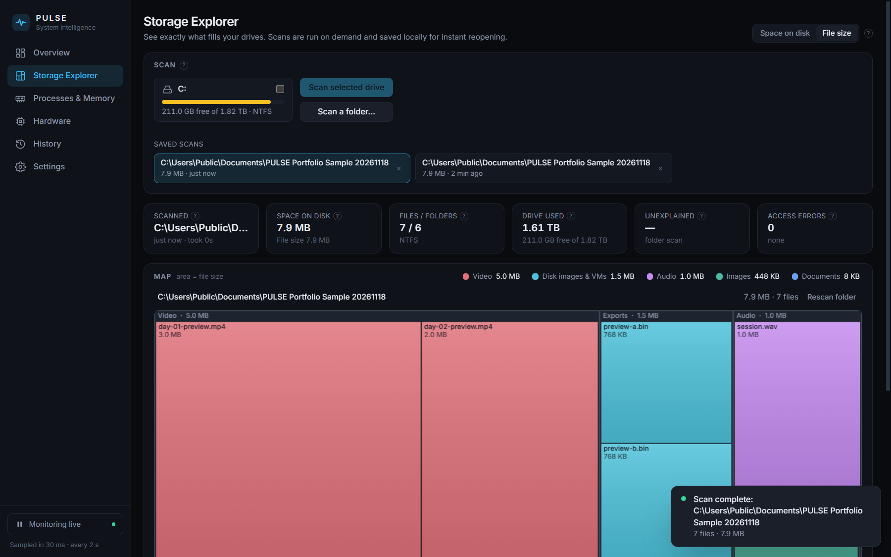
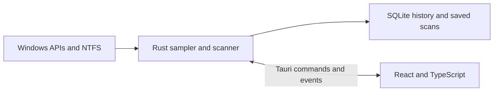
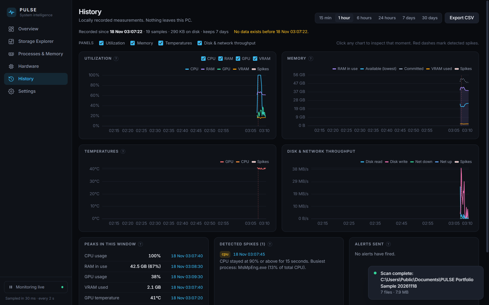

# PULSE

PULSE is a local Windows system monitor for finding what occupies disk space and investigating when CPU, memory, or GPU usage changed.



## What it does

- **Storage Explorer** scans a folder or volume on demand. Drill into the treemap, switch between allocated and logical size, filter results, and reopen saved scans. The coverage view reports paths the scanner could not read.
- **Processes & Memory** shows process working sets, commit, CPU and available GPU measurements alongside Windows memory composition. Recorded snapshots help explain which processes grew around a spike.
- **History** records samples in a local SQLite database, with configurable retention, timeline inspection and CSV export. Live monitoring can be paused from any view.

## Architecture

Windows APIs provide filesystem and telemetry data to a Rust core. The core owns sampling, scan jobs, persistence and system actions. Tauri commands and events connect it to a React and TypeScript interface. ECharts renders time series and the storage view uses a zoomable treemap.



## Run on Windows

Use Windows with WebView2, a Vite-compatible Node.js version (20.19+, 22.12+, or newer supported releases, verified on 26.13.1), and the Rust MSVC toolchain with the Visual Studio C++ build tools and Windows SDK.

```powershell
npm ci
npm run tauri -- build --debug --no-bundle
.\src-tauri\target\debug\pulse.exe
```

Open **Storage Explorer → Scan a folder** and choose a directory. In **Processes & Memory**, check that live values update. **History** begins filling as the app runs. Settings, history and scans are stored under `%APPDATA%\PULSE`.

## Verification

```powershell
npm run build
cargo test --locked --manifest-path src-tauri/Cargo.toml
```

The TypeScript/Vite build and Rust debug build passed. The Rust test target compiled with zero tests. The native WebView2 run scanned an NTFS fixture containing seven files across five child folders, checked the saved scan count, switched to logical size and drilled into a child folder. It also observed advancing timestamps, a rendered history chart, a nonempty process list, and working pause/resume.

The seven-file scan reached the first expected rows in about 20 ms on the verification machine, measured from the native scan request to the rendered row on one warm rerun. This fixture checks end-to-end behavior. It gives no throughput estimate for a full volume.

<details>
<summary>Recorded telemetry in the native app</summary>



</details>

## Status and limitations

PULSE is an early Windows desktop project. Windows permissions can limit scan coverage. Logical byte counts can differ from allocated storage, and the process I/O counter includes more than disk traffic. Some board sensors require an elevated LibreHardwareMonitor process on loopback. This verification covered read-only workflows at standard permissions. It did not cover elevated sensor collection, process termination, recycling files, or release installer behavior.

The project is [MIT licensed](LICENSE). For engineering context and remaining work, see the [progress log](PROGRESS.md) and [review notes](ENGINEERING_REVIEWS.md).
